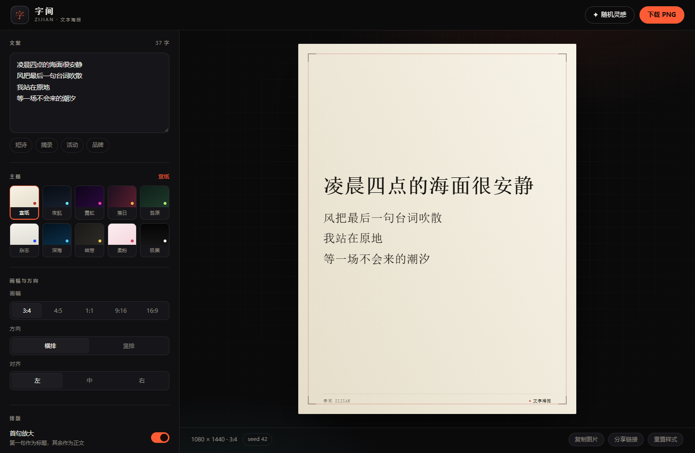
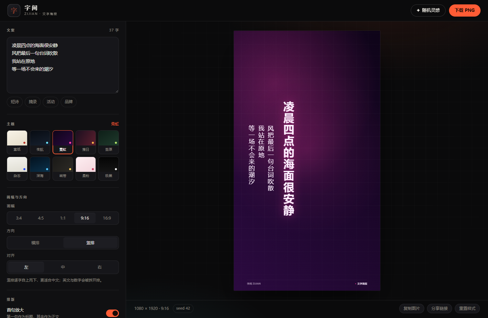

# 字间 ZIJIAN · 文字海报生成器

输入一段文字，在浏览器里排成一张能直接发的海报。

零依赖、零构建、零后端：没有 npm 包，没有打包器，没有上传，没有登录。全部排版与出图都在本地 Canvas 完成，断网也能用。



## 特性

- **排版引擎自己写**：中文按字换行、英文单词不拆、行首/行尾禁则（避免「，」出现在行首）、字号自适应直到放得下（下限 10px）
- **竖排**：逐字自上而下，列自右向左，标点按禁则处理
- **10 套主题**：宣纸、夜航、彩虹、落日、苔原、钴蓝、深海、磁带、柔粉、极简；装饰（细边框 / 网格 / 光晕 / 色条 / 水印）与颗粒纹理全部程序化绘制，不加载任何外部图片
- **5 种画幅**：3:4、4:5、1:1、9:16、16:9
- **实时预览**：输入后一帧内更新，不做 loading 态
- **2 倍高清导出**：1:1 出 2160×2160，3:4 出 2160×2880；另支持复制到剪贴板
- **可复现的随机**：seed 驱动的随机风格，同 seed 结果完全一致
- **分享链接**：样式与文案编码进 URL hash（`#s=`），打开即还原
- **本地记忆**：刷新后恢复上次的文案与样式（localStorage）
- **无障碍与移动端**：语义化标签、`aria-*` 状态、键盘可达，390px 窄屏可用



## 在线体验

- Vercel：<https://zijian-poster.vercel.app>
- GitHub Pages：仓库启用 Pages 后由 `.github/workflows/pages.yml` 自动发布 `src/`

## 本地运行

项目没有构建步骤，任意静态服务器都能跑（不能直接双击 `index.html`，因为用了 ES Modules）：

```bash
# 方式一：Node 内置，无依赖
npx serve src

# 方式二：Python
python -m http.server 8080 --directory src
```

然后打开 <http://localhost:3000>（或 8080）。

## 项目结构

```text
.
├── src/                    # 站点本体，可直接部署
│   ├── index.html
│   ├── css/style.css
│   ├── js/core/            # 纯逻辑，可在 Node 里直接测试
│   │   ├── rng.js          # 可复现随机数
│   │   ├── presets.js      # 主题 / 画幅 / 字体 / 文案
│   │   ├── spec.js         # 状态归一化、分享 hash、文件名
│   │   ├── text-layout.js  # 断行、禁则、字号自适应、竖排
│   │   ├── renderer.js     # Canvas 绘制
│   │   └── exporter.js     # 导出与复制
│   ├── js/ui/app.js        # 交互与状态
│   └── vercel.json
├── tests/                  # node:test 用例 + fixtures
├── ci/                     # precheck / test / smoke 三个自检脚本
├── docs/screenshots/       # README 用图
├── prd.md                  # 需求与验收标准
├── architecture.md         # 技术方案
├── api-contract.yaml       # 模块契约（frozen）
├── brief.md / deploy.md    # 需求基线与部署记录
└── package.json            # 只声明脚本，无 dependencies
```

`src/js/core/` 不依赖 DOM，因此能在 Node 里跑单测；`src/js/ui/app.js` 是唯一接触 DOM 与事件的地方。

## 测试与自检

```bash
npm test           # node --test tests/*.test.js（35 项）
node ci/precheck.mjs   # 文件齐全、无外链资源、无裸模块 import、vercel.json 合法
node ci/smoke.mjs      # 起临时静态服务，验证关键资源 200 且 MIME 正确
```

CI 配置在 `.github/workflows/ci.yml`，push 与 PR 都会跑这三项。

## 隐私

- 文案不上传：没有后端，也没有任何网络请求
- 不加载网络字体与图片，只用系统字体渲染（不同设备字形会略有差异）
- 导出走 `canvas.toBlob()`，全程在内存里完成

## 贡献

欢迎 issue 与 PR。改动前请先跑 `npm test` 和 `node ci/precheck.mjs`，两者都要求零告警通过。

## 许可证

[MIT](LICENSE)
